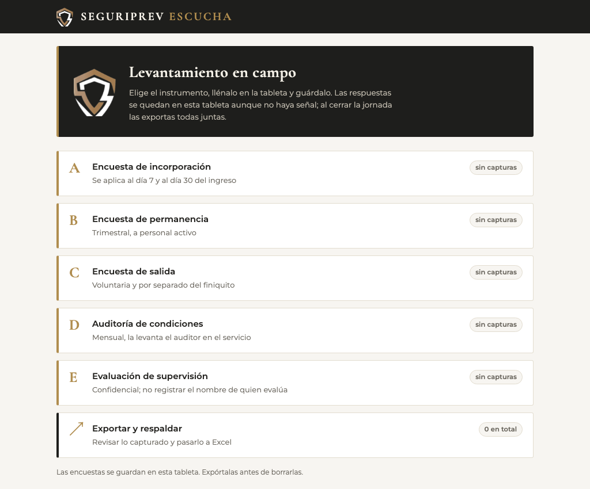

  

<h1 align="center">ESCUCHA</h1>

  Levantamiento en campo de los cinco instrumentos del programa 
  <b>SEGURIPREV ESCUCHA</b> — rotación, permanencia y calidad operativa.

  <a href="https://luisrodrigoag-pixel.github.io/escucha/"><b>Abrir la aplicación →</b></a>

  

---

## Los instrumentos

| | Instrumento | Cuándo se aplica |
|---|---|---|
| **A** | Encuesta de incorporación | Al día 7 y al día 30 del ingreso |
| **B** | Encuesta de permanencia | Trimestral, a personal activo |
| **C** | Encuesta de salida | Voluntaria y por separado del finiquito |
| **D** | Auditoría de condiciones | Mensual, la levanta el auditor en el servicio |
| **E** | Evaluación de supervisión | Confidencial; sin el nombre de quien contesta |

## En el iPad

1. Abrir la liga en **Safari**.
2. Compartir › **Añadir a pantalla de inicio**. Queda como app, con el escudo y sin barra del navegador.
3. Elegir el instrumento, llenarlo y **Guardar encuesta**. Funciona sin señal.
4. Al cerrar la jornada: **Exportar y respaldar** › *Copiar* para pegar en Excel, o **Descargar CSV**
   para abrirlo en Numbers o mandarlo por correo.

## Dónde viven las respuestas

En la **tableta**, en el almacenamiento local del navegador. Esta página es estática: no hay
servidor ni base de datos, y por eso se puede levantar una encuesta en una caseta sin señal.

> **Lo que no se exporta, se pierde.** Si se borran los datos de Safari o se reinstala el acceso
> directo, no hay copia en ningún otro lado. Cada tableta guarda lo suyo y no ve las de las demás.

## Confidencialidad

El instrumento **E** es confidencial y no debe registrar el nombre de quien contesta. Conforme al
manual del programa, los supervisores no tienen acceso a las respuestas individuales sobre su
propia evaluación, y los señalamientos de violencia, acoso o amenazas se canalizan por protocolo
sin esperar al reporte mensual.

## Mantenimiento

Todo vive en `index.html`: sin dependencias, sin compilación, sin paso de construcción. Se edita y
se sube. Las preguntas de cada instrumento están en el arreglo `INSTRUMENTOS`, al principio del
script; agregar un reactivo es agregar un renglón.

| Archivo | Qué es |
|---|---|
| `index.html` | La aplicación completa |
| `logo.png` · `escudo.png` | Marca institucional |
| `icon-512.png` · `icon-192.png` · `apple-touch-icon.png` | Íconos de pantalla de inicio |
| `manifest.webmanifest` | Para que se instale como app |

Protección y Seguridad Privada SECURITAS, S. de R.L. de C.V. · Uso interno

